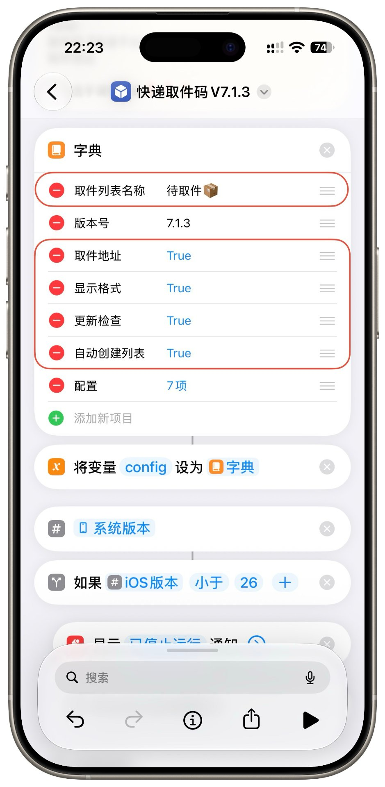

# 快递取件码 · iOS 快捷指令

> 自动提取快递取件码、运单号、取件地址，一键写入「提醒事项」
> 纯本地运行 · 无需第三方 App · 无广告


## 📣 项目声明

- **原创内容**：本「快递取件码」快捷指令由作者从零独立设计、编写与持续维护，非搬运、非二改他人作品。
- **合规开放**：遵循 Apple 快捷指令与开源社区相关规范，以 [MIT 许可证](LICENSE) 公开发布，代码结构透明、可自由查看与审阅。
- **永久免费**：本指令**无任何收费行为**——不含付费功能、不打赏要求、不诱导消费，纯粹「为爱发电」。
- **数据自主**：全程本地运行，取件数据仅存于你的设备，作者不收集、不上传任何个人信息。

> 如发现无法识别的快递短信，或对功能有建议，欢迎通过 Issue 或社交媒体反馈，作者会持续迭代优化。

## ✨ 功能特性

- 📦 **自动提取关键信息**：取件码、运单号、快递公司、取件地址/驿站名称
- 🔢 **多码匹配**：一条短信多个取件码（如 `Z-0102,F1-1818`）也能一次性提取
- 🚚 **覆盖 30+ 家快递**：顺丰、圆通、申通、中通、韵达、邮政、京东、极兔、菜鸟等
- ✅ **智能去重 + 自动打勾**：同一条短信重复分享不会生成重复记录
- 🔔 **取件通知**：添加到提醒事项后推送系统通知
- 🔒 **本地离线**：不依赖网络，数据仅保存在你自己的设备上

## 📲 获取方式

### 方式一：扫码获取（推荐）

用 iPhone 相机扫描上方二维码，直接添加快捷指令。

### 方式二：iCloud 链接

点击下方链接，在 Safari 中打开即可添加：

```
https://www.icloud.com/shortcuts/b687a0f5b92c4f4fa30efa0fec362678
```

> 💡 **提示**：打开链接后选择「获取快捷指令」，首次使用需在「设置 → 快捷指令」中允许运行。

### 方式三：仓库直接下载

适合想本地保存 `.shortcut` 文件的用户（文件已改为 ASCII 命名，便于脚本化抓取）：

```
https://gitee.com/zhang_wangning/shortcut_pickup_code/raw/master/pickup-code.shortcut
```

### 📜 微信公众号获取方式

也可通过**微信公众号关键词自动回复**获取快捷指令，具体步骤：

1. 打开微信，搜索并关注公众号「**极客 ZHANG**」；
2. 在公众号对话框中**回复关键词 `0525`**；
3. 公众号会自动下发**最新版本**快捷指令的获取链接，按提示添加即可。

> 旧版本不再单独提供，回复 `0525` 获取到的始终为**当前最新版**。扫码 / iCloud / 仓库下载方式见上方，二者等价。

## 📖 使用方法（完整教程）

> 本教程基于「快递取件码」快捷指令的真实操作流编写。指令本体由 128 个动作组成，通过正则从短信中提取取件码、运单号、取件地址，并写入「提醒事项」实现集中管理。全程本地运行，无需第三方 App。

### 一、使用前准备

#### 1. 提醒事项列表（无需手动创建）

快捷指令首次运行时会自动检测配置中指定的提醒列表是否存在（默认名称为"待取件📦"）。若不存在，指令会自动创建该列表，因此不需要提前手动新建。

如果你希望使用自定义列表名，只需在指令的"词典"模块中修改"取件列表名称"的值，并与提醒事项中的列表名保持一致即可（指令会自动创建，通常无需手动操作）。

#### 2. 开启必要权限

- 打开 iOS「设置 → 快捷指令」，开启「iCloud 同步」与「私人共享」（不同系统版本名称略有差异，核心是允许快捷指令正常安装与运行）。
- 首次运行本指令时，系统会请求「提醒事项」的访问权限，请点击「允许」。若拒绝，指令将无法写入取件记录。

### 二、配置快捷指令参数

在「快捷指令」App 中打开「快递取件码」指令，找到内部的"词典"模块进行配置：

- 取件列表名称：写入结果的目标提醒列表名，默认"待取件📦"。修改后需与实际列表名一致。
- 取件地址：填写 True 显示取件地址，填写 False 隐藏地址。
- 快递公司 / 驿站列表：词典中以字符串数组形式保存了顺丰、圆通、申通、中通、韵达、京东、极兔、菜鸟等数十家快递公司与代收点名称（含 SF、STO、ZTO、EMS、J&T 等英文标识）。这些关键词是指令识别有效取件短信的判断依据。如某家快递或驿站暂未被识别，请将原始短信发送至微信公众号或小红书私信，由作者适配，无需自行修改。

常用配置项一览（小白建议保持默认）：

| 配置项 | 默认值 | 说明 |
| --- | --- | --- |
| 取件列表名称 | `待取件📦` | 存放取件记录的提醒事项列表名，可自定义 |
| 取件地址 | `True` | 设为 `False` 可隐藏取件地址 |
| 显示格式 | `True` | 控制「快递平台 / 取件码 / 取件地址」三要素排列顺序 |
| 更新检查 | `True` | 在线版本检查开关；改为 `False` 可离线运行（不再中断取件流程） |
| 自动创建列表 | `True` | 首次运行是否自动创建「待取件📦」列表 |
| 版本号 | `7.2.1` | 当前版本（只读，勿改） |

> ⚠️ 小白用户建议保持所有默认值，无需更改。

### 三、配置短信自动触发（核心步骤）

本指令的工作逻辑是：手机收到短信 → iOS 自动化检测到内容包含 `【` → 自动运行「快递取件码」指令 → 提取取件信息写入提醒事项。因此，配置短信自动触发是使用本指令的必要前提，而非可选项。

> 注意：自动化必须在「**快捷指令**」App 中创建，"信息"只是触发类型；不能在「信息」App 里设置。

配置步骤如下：

1. 打开「快捷指令」App，点击左侧边栏的「自动化」标签页。
2. 点击右上角「+」，新建「个人自动化」，触发器选择「信息」（图标为绿色对话气泡）。
3. 设置触发条件：
   - 选择「信息 包含」
   - 在输入框中填入 **`【`** （中文左方括号，不含引号）
   - 绝大多数正规快递通知短信均以【公司名】开头，包含 `【` 可有效筛选快递类信息
4. 点击「下一步」进入动作配置界面，在搜索框中搜索并添加「运行快捷指令」动作。
5. 在「运行快捷指令」的下拉列表中选择 **「快递取件码」**。
6. 配置变量传递（关键步骤）：
   - 点击「运行快捷指令」动作下方的「输入」区域
   - 选择「选取变量 → 输入快捷指令的信息」
   - 此操作将本次自动化捕获的完整短信全文作为参数传递给指令进行处理
7. 关闭「运行前确认」，开启「立即运行」，实现收到短信后后台静默处理。

> 注意：配置完成后，自动化默认处于关闭状态（如截图中右上角开关所示）。你需要手动将开关打开才能生效。

### 四、工作逻辑与运行效果

完成上述配置后，日常使用无需任何手动操作——只要收到符合条件的快递短信，系统就会自动完成以下处理：

1. **自动触发**：短信到达且内容包含 `【` 时，iOS 自动化在后台静默触发「快递取件码」指令。
2. **信息传递**：自动化将整条短信全文作为输入变量传递给指令。
3. **智能提取**：指令通过正则从短信中抓取取件码、运单号、快递公司、取件地址或驿站名称。
4. **写入提醒**：结果被整理并写入「提醒事项」的"待取件📦"列表。
5. **推送通知**：写入后推送系统通知，避免漏看。
6. **查看与打勾**：打开「提醒事项」即可看到整理好的取件清单，取件后直接打勾。

**内部机制：**
- 智能去重：同一短信重复推送时，已存在的取件记录会被标记完成，不会生成重复项。
- 循环与分支：指令内部通过循环批量处理多个取件码（如一条短信含多个取件码），通过条件分支应对不同公司、不同短信格式以及是否已记录的情况。

### 五、V7.2.1 在线更新说明（重要）

V7.1.0 起引入了**在线版本检查**功能：指令启动时会联网拉取仓库中的 `version.json`，比对 `versionCode` 判断是否有新版本。V7.2.1 进一步优化了此功能。

- **需要联网**：此功能依赖网络请求。如果设备处于离线环境，且未做以下配置，指令可能无法正常运行。
- **V7.2.1 优化**：关闭「更新检查」后，**不再中断指令运行**，而是通过系统通知推送新版本提示（标题：「【快递取件码】版本更新通知，请立即更新」），取件流程照常执行。

#### 如何关闭在线更新检查

如果你暂时不想联网使用、或不希望每次启动都检查版本，按以下步骤操作：

1. 打开「快捷指令」App → 找到并打开「**快递取件码 V7.2.1**」
2. 找到最上方的 **「字典」** 动作（第一个字典，即配置字典）
3. 在字典列表中找到名为 **「更新检查」** 的条目
4. 将其值由 **True** 改为 **False**



上图为 V7.2.1 配置字典的完整界面，包含以下**全部可配置项**（见上方第二节表格）。

> ⚠️ **离线模式 vs 联网模式**：关闭更新检查后，你将不会收到新版本提示。建议在有网络时定期打开检查一次，或在仓库页面手动查看是否有新版发布。

#### 自动创建列表（V7.2.1 默认开启）

首次保存快捷指令时，系统会弹出「配置此快捷指令」页面，可在此编辑「自动创建列表」开关（默认 True）。保存后也可随时在字典中修改。

### 六、常见问题

1. **隐私说明**：本指令在设备本地读取短信内容并提取。首次运行需授权提醒事项访问权限；若关闭该权限，指令将无法工作。短信数据仅在本地处理，不联网上传（在线版本检查除外，见第五节）。
2. **没有自动生成记录**：检查自动化中是否开启了「立即运行」，以及触发条件是否为「信息 包含 【」；同时确认自动化开关已打开（配置完成后默认关闭）。
3. **某家快递无法识别**：如果无法匹配提取取件码，请将原始短信内容发送至**微信公众号或小红书私信**，收到后会着手适配（无需用户自行修改指令）。
4. **多设备同步**：若 iPhone 与 iPad 登录同一 Apple ID 并开启自动化同步，建议仅在一台设备上启用短信自动化，避免重复触发生成两条记录。

### 附录：iOS 自动化设置参考（iOS 27）

> 以下截图为 iOS 27 系统下的**短信自动化触发**实际配置界面，照着操作即可完成设置。


#### 截图说明

上图中包含两个关键配置区域，逐一对照：

#### ① 触发器（上半部分）

| 设置项 | 正确值 | 说明 |
| --- | --- | --- |
| 触发类型 | **我收到符合以下条件的信息时** | 选择「信息」触发器 |
| 条件 | **信息 包含 【** | 填入中文左方括号 `【`（非半角 `[`） |
| **自动化开关** | ✅ **开启**（绿色） | 配置完成后必须手动打开，否则不会自动运行 |
| **运行前确认** | ❌ **关闭**（灰色） | 关闭后收到短信才会在后台静默执行，不会弹窗询问 |

#### ② 动作（下半部分）

| 设置项 | 正确值 | 说明 |
| --- | --- | --- |
| 动作类型 | **运行 快递取件码 V7.2.1** | 在下拉列表中选择本指令 |
| 输入变量 | **输入快捷指令的信息** | 将整条短信内容传给指令处理 |

#### 完整配置步骤（7 步）

如果从零开始新建自动化，按以下顺序操作：

1. 打开「快捷指令」App → 左侧边栏点击「**自动化**」标签
2. 点击右上角「**+**」→ 选择「**个人自动化**」
3. 触发器选择「**信息**」（绿色对话气泡图标）
4. 设置条件为「**信息 包含 【**」
5. 点击「下一步」→ 搜索并添加「**运行快捷指令**」动作
6. 选择「**快递取件码 V7.2.1**」，输入设为「**输入快捷指令的信息**」
7. 关闭「**运行前确认**」，打开「**自动化**」开关

> ⚠️ 配置完成后，「自动化」开关默认是**关闭**的。你需要手动打开它才能生效——这是 iOS 的安全机制，防止误触发。

## 🔧 技术原理

整个指令由 **128 个动作**组成，分为 8 个阶段：

| 阶段 | 动作范围 | 作用 |
| --- | --- | --- |
| 在线更新检查 | 1–22 | 拉取仓库 version.json，比对版本号，有更新时展示 changelog（关闭后改走通知） |
| 配置与字典管理 | 23–42 | 初始化参数，自动创建提醒列表（可关闭） |
| 短信匹配预检 | 43–58 | 四参数检测（取件码/运单号/尾号/特殊格式），全无则退出 |
| 写入提醒事项 | 59–70 | 把结果固化成可追踪的记录 |
| 循环处理 | 71–86 | 批量处理多条 / 多个匹配项 |
| 提取关键信息 | 87–117 | 用正则抓取取件码、运单号、尾号、站点、特殊格式 |
| 条件判断（一） | 118–135 | 按快递公司 / 格式 / 显示格式分流 |
| 条件判断（二） | 136–150 | 按是否已记录分流 |

**六套正则协作（全部由 config 字典的「配置」子字典驱动）**：
- 快递平台正则：识别 30+ 家快递 / 驿站 / 智能柜（含 SF、STO、ZTO、EMS、J&T 等英文标识）；无【】时兜底「未知包裹」
- 取件码正则：支持连字符、字母混合、纯数字，并排除 11 位手机号误识别
- 运单号正则：识别 `SF`/`JD` 等长单号格式；含尾号匹配 `(?<=尾号为?)…(?=快件)`
- 特殊格式取件码正则：覆盖含顿号/逗号的不规则取件码（如 `4、4、3486`），连接符统一为 `-`
- 取件地址正则（单条合并公式）：精确匹配驿站 / 快递柜 / 代收点

## 📋 版本历史

完整变更记录见 [CHANGELOG.md](CHANGELOG.md)。下方为**已归档版本**（含安装包 / 截图）；V7.0.0 与 V6.4.0/1/2 仅有变更文档、无独立安装包。

### 已归档版本

| 版本 | 发布日期 | 类型 | 资料 |
| --- | --- | --- | --- |
| **V7.2.1** | 2026-08-15 | **当前发行版** | [releases/v7.2.1](releases/v7.2.1/)（二维码 + 说明） |
| V7.1.3 | 2026-08-12 | 历史归档 | [releases/v7.1.3](releases/v7.1.3/)（二维码 + 安装包） |
| V7.2.0 | 2026-08-15 | 内测（历史归档） | [releases/v7.2.0](releases/v7.2.0/)（字典截图 + 说明 + 公式实测） |
| V7.1.0 | 2026-08-08 | 历史归档 | [releases/v7.1.0](releases/v7.1.0/)（二维码 + 说明） |
| V6.4 | 2025-06-09 | 历史归档 | [releases/V6.4](releases/V6.4/)（16 张教程攻略截图） |
| V5.0 | 2025-03-27 | 历史归档 | [releases/V5.0](releases/V5.0/)（6 张） |
| V4.0 | 2025-03-22 | 历史归档 | [releases/V4.0](releases/V4.0/)（5 张） |
| V3.0 | 2025-03-12 | 历史归档 | [releases/V3.0](releases/V3.0/)（5 张） |

### 仅文档记录（无独立安装包，详见 CHANGELOG）

- **V7.0.0**（2026-08-03）：正则架构重构，未公开发包
- **V6.4.2**（2026-06-07）/ **V6.4.1**（2026-06-05）/ **V6.4.0**（2025-05-25）：早期迭代

> 📜 **微信公众号获取**：关注公众号「极客 ZHANG」并回复 `0525`，可获取**最新版本**快捷指令；V7.0.0 及更早版本也可通过此渠道联系作者获取，详见上方「获取方式」章节。

## 🔄 在线更新

本仓库通过根目录的 [`version.json`](version.json) 提供**机器可读的版本信息**，快捷指令可主动拉取并比对，实现在线更新提示（无需手动关注推送）。

- **版本信息源（raw 直链，供快捷指令「获取 URL 内容」调用）**：
  ```
  https://gitee.com/zhang_wangning/shortcut_pickup_code/raw/master/version.json
  ```
- **比对机制**：快捷指令自身保存一个 `versionCode`（当前 V7.2.1 = `721`）；拉取上述 JSON 后比较 `current.versionCode`，若数值更大即提示有新版本，并展示 `current.changelog` 更新要点。
- **新版入口**：JSON 中的 `current.icloudUrl` 与 `current.shortcutRawUrl` 即最新版获取地址。

> 📌 **发版约定**：每次更新快捷指令，只需同步更新 `version.json` 的 `current` 字段（版本号 / versionCode / releaseDate / changelog）并提交仓库，即自动成为可信的版本信息源——这也是本仓库存在的核心目的之一。

## 🤝 反馈与支持

- 使用中遇到问题？欢迎提交 [Issue](https://gitee.com/zhang_wangning/shortcut_pickup_code/issues)
- 有功能建议？欢迎讨论或提交 PR
- **快递无法识别**？将原始短信发送至以下任一渠道，作者会着手适配：

### 📱 联系作者

| 渠道 | 说明 |
| --- | --- |
| **微信公众号** | 「**极客 ZHANG**」— 探索科技 · 记录生活 · 传递灵感（回复 `0525` 可获取最新版快捷指令） |
| **小红书** | 「**极客 ZHANG**」（zwn1652503532）— 扫码或搜索用户名即可找到 |


> 💬 通过公众号或小红书私信反馈时，请附上**原始短信内容**（可打码手机号等隐私信息），以便精准定位正则匹配问题。

## 📄 许可证

本项目以 [MIT 许可证](LICENSE) 开源，可自由使用、修改与分发。

Copyright © 2026 ZhangWangning.
