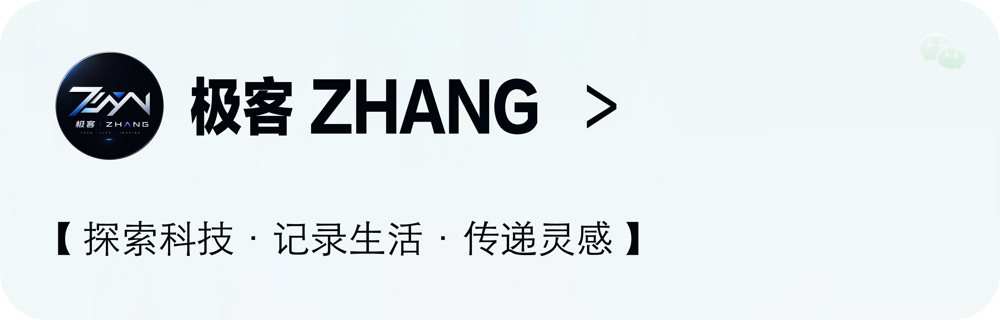

# 快递取件码 · iOS 快捷指令

> 自动提取快递取件码、运单号、取件地址，一键写入「提醒事项」
> 纯本地运行 · 无需第三方 App · 无广告 · 永久免费

> 🆕 **当前发行版：V8.0.2（免费）** — 永久免费，本仓库不提供安装包与 iCloud 安装链接，获取方式见下方「V8.0.2 更新说明」。
> 🔒 **纯本地离线运行** — 指令内**不含任何网络请求**，也不做在线更新检查；开箱即用，断网照跑。
> 📱 **系统要求：iOS 27 及以上** — iOS 27 以下的系统**不再支持**本版本，请勿在旧系统上安装。
> 📦 **V7.3.0 及更早版本已停止分发** — 仓库不保留任何旧版安装入口；**已安装用户可继续长期免费使用**。

## 📣 项目声明

- **原创内容**：本「快递取件码」快捷指令由作者从零独立设计、编写与持续维护，非搬运、非二改他人作品。
- **永久免费**：本快捷指令**永久免费**，所有功能完整开放，没有试用、没有内购、没有订阅。
- **合规开放**：遵循 Apple 快捷指令与开源社区相关规范，以 [MIT 许可证](LICENSE) 公开发布，代码结构透明、可自由查看与审阅。
- **离线与隐私**：全程本地运行，**不含任何联网动作**，不检查更新、不上报任何数据；取件数据仅存于你的设备，作者不收集、不接触任何个人信息。
- **版本与分发说明**：V7.3.0 及此前版本已停止分发（仓库不保留任何安装入口）；当前发行版为 **V8.0.2**，本仓库仅提供版本说明与设计文档，不提供安装包。

> 如发现无法识别的快递短信，或对功能有建议，欢迎通过 Issue 或社交媒体反馈，作者会持续迭代优化。

## 🆕 V8.0.2 更新说明（免费 · 2026-10-27）

> 本版修复 V8.0.1 的两个致命问题：配置转义污染导致凭证完全失效、凭证混入尾号。同时移除尚未正式提供的地址导航测试功能。

### 相对 V7.3.0 的更新内容（简要）

1. **能看出是哪家快递**：新增「快递公司」识别，从正文抓真正的承运方（覆盖 30 家品牌，排除「圆通超市」这类店名语境）。103 条真实短信中 69 条识别出公司，其中 34 条显示值与原来不同——典型是「拼多多 → 圆通快递」「妈妈驿站 → 圆通快递」「兔喜生活 → 邮政」。
2. **有几号柜就写出来**：新增「快递柜」识别（`2号` / `A3` / `一号` / `02-23格口`），跟在取件码后面：`0425-0007·2号`。
3. **地址更干净**：修复「…快递驿站2号柜（请前往」括号截断、「家门口签收」多带两字、「预约时间上门」误当地址、「到店扫码」切出「店扫」碎片等问题。
4. **银行短信不再误抓**：尾号排除补强（转入/转出/汇出/入账/人民币），全库 372 条中 9 条银行短信误抓全部消除，21 条真实快递尾号零影响。
5. **凭证拆两层**：主层（取件码 + 特殊格式）优先、保留多码；主层为空时由备用层（运单号 + 尾号）接管。动作数 138 → 144。
6. **修复配置转义污染**：V8.0.1 安装包内的公式带双反斜杠，导致凭证完全匹配不到，本版已恢复。

### 系统要求

| 项目 | 要求 |
| --- | --- |
| iOS 版本 | **iOS 27 及以上** |
| 设备 | iPhone（需已安装「快捷指令」App） |

> ⚠️ **iOS 27 以下的系统不再支持**。V8.0.2 使用了 iOS 27 才有的动作与参数，在 iOS 26 / iOS 18 等旧系统上导入会失败或运行异常。如果你的设备还停留在旧系统，请继续使用手头已有的旧版（旧版不受影响，可长期免费使用）。

### 如何获取

V8.0.2 为**免费版本**，通过 **小红书「极客 ZHANG」（zwn1652503532）** 获取：在小红书搜索进入该账号，按主页笔记中的说明获取。**本仓库不提供安装包与 iCloud 安装链接。**

### 旧版本说明（已停止分发）

V7.3.0 及更早版本**不再提供任何安装入口**；**已安装用户无需任何操作，可继续长期免费使用**。若设备已升级到 iOS 27 及以上，可直接换成 V8.0.2；仍在 iOS 26 及更早系统的，继续用旧版即可（旧版不依赖网络，功能不受影响）。

## ✨ 功能特性

- 📦 **自动提取关键信息**：取件码、运单号、快递公司、取件地址/驿站名称、快递柜号
- 🚚 **认得出是哪家快递**：从正文识别实际承运方（30 家品牌），不再只显示「拼多多」这类平台名
- 🗄 **柜号自动标出**：有「2号柜」「A3」的短信，柜号跟在取件码后面
- 🔢 **多码匹配**：一条短信多个取件码（如 `Z-0102,F1-1818`）也能一次性提取
- ✅ **智能去重 + 自动打勾**：同一条短信重复分享不会生成重复记录
- 🔔 **取件通知**：添加到提醒事项后推送系统通知
- 🔒 **纯本地离线**：不含任何联网动作，不检查更新、不上传数据

## 📲 获取方式

> 🆕 **当前发行版：V8.0.2（免费）**，获取方式见下。
> 📦 **V7.3.0 及更早版本已全部停止分发** —— 仓库不提供任何旧版本的二维码 / iCloud 链接 / 安装包下载；已安装用户可继续正常使用，不受任何影响。

### V8.0.2（当前发行版本 · 永久免费）

V8.0.2 为**免费版本**，通过 **小红书「极客 ZHANG」（zwn1652503532）** 获取：在小红书搜索进入该账号，按主页笔记中的说明获取。

**本仓库不提供任何形式的安装入口**（无安装包、无二维码、无 iCloud 链接）。

> 💡 **不再有在线更新**：自 V8.0.1 起已移除全部联网动作，指令内不做版本检查。有新版本时作者会在小红书发布，需要新版的用户到该账号获取即可；你手上的旧版也会一直能正常用。

### 旧版本说明

- **已安装** V7.3.0 及更早版本的用户：**无需任何操作**，可继续长期免费使用；
- **不再提供**任何旧版本的新安装入口，`releases/` 各版本目录仅作**历史记录与设计参考**。

## 📖 使用方法

> **V8.0.2 的完整使用教程**（配置项说明、短信自动化设置、常见问题、各 iOS 版本配置截图）**随版本在小红书「极客 ZHANG」的笔记中提供**。

## 🔁 它是怎么跑起来的

这个快捷指令自己不会动。真正让它跑起来的是 iPhone 的「自动化」。

用法是在「快捷指令」App 里建一条自动化规则，触发条件选「**收到短信时**」。之后每来一条短信，iPhone 就会在后台把这个快捷指令自动跑一遍——不用你点，也不用打开 App。

跑起来之后做四件事：

1. **拿到短信原文** —— 就是刚收到的那条短信的完整文字
2. **判断是不是快递短信** —— 不是的话直接退出，什么都不做，不会骚扰你
3. **分析短信内容** —— 从里面挑出取件码（或运单号 / 尾号）、哪家快递送的、去哪取、几号柜
4. **写进提醒事项** —— 在「待取件📦」列表里生成一条记录，标题是取件码，第二行是快递公司加地址

整个过程都在手机本地完成，不联网、不上传。

> 所以它依赖两样东西：**iPhone 收到短信**，以及**「快捷指令」App 的自动化**。少了任何一个都不会触发。自动化那一步需要你自己在 App 里建一次，建完就一直有效。

## 🔧 技术原理

> 以下为 **V8.0.2（144 个动作）** 的结构概要；V7.3.0（138 个动作，四层互斥分支）的差异见 [releases/v7.3.0](releases/v7.3.0/)。

整个指令由 **144 个动作**组成，全程无网络请求：

| 阶段 | 作用 |
| --- | --- |
| 配置与字典管理 | 初始化参数，按需自动创建「待取件📦」列表并设置徽章 |
| 短信预检 | 先用关键词粗筛，再用合并后的凭证公式判断是否含取件码，全空即退出 |
| 提取关键信息 | 六条正则分别抓取件码、快递公司、短信平台、取件地址、快递柜号 |
| 标题排版 | 按「有/无柜号 × 有/无名称 × 有/无地址」组合出 7 种标题样式 |
| 写入提醒事项 | 可选取件地址生成地图链接填入 URL 字段；同一条短信自动去重 |

**六套正则协作（全部由 config 字典的「配置」子字典驱动）**：

- **关键词**：24 个词做第一道粗筛（快递/快件/取件/取货/提货/包裹/丰巢/驿站/各品牌名等）
- **取件码（合并公式）**：原来分开的「取件码 / 运单号 / 尾号 / 特殊格式取件码」四套规则整合为一条。取件码优先，运单号与尾号分支前置全文断言避免抢占；支持连字符、字母混合、4–8 位纯数字，并用负向前瞻排除 11 位手机号
- **快递公司**：30 家承运品牌，`(?!超市|驿站|代收|快递柜)` 排除店名语境
- **短信平台**：`(?<=【)[^】]+` 直接取括号内容，无需二次去括号
- **取件地址**：单条合并公式，含「正在派送」「预约时间上门」等脏值防御
- **快递柜**：柜号可出现在「柜」字前或后，排除楼栋号 / 驿站号 / 门牌号 / 日期

## 📋 版本历史

完整变更记录见 [CHANGELOG.md](CHANGELOG.md)。下方为**历史版本记录**（说明 / 截图，自 2026-09-20 起**不含任何安装入口**）；V7.0.0 与 V6.4.0/1/2 仅有变更文档、无独立安装包。

### 版本一览

| 版本 | 发布日期 | 类型 | 资料 |
| --- | --- | --- | --- |
| **V8.0.2** | 2026-10-27 | **当前发行版（免费）** | [releases/v8.0.2](releases/v8.0.2/)（更新说明，**不含安装入口**） |
| V8.0.1 | 2026-10-26 | 历史版本（已被 V8.0.2 取代） | [releases/v8.0.1](releases/v8.0.1/)（更新说明） |
| V7.3.0 | 2026-09-20 | **已停止分发** | [releases/v7.3.0](releases/v7.3.0/)（更新说明 + 解析报告） |
| V7.2.1 | 2026-08-15 | **已停止分发**（已装用户可继续免费使用） | [releases/v7.2.1](releases/v7.2.1/)（说明 + 史料） |
| V7.1.3 | 2026-08-12 | 历史归档（安装入口已移除） | [releases/v7.1.3](releases/v7.1.3/)（说明 + 史料） |
| V7.2.0 | 2026-08-15 | 内测（历史归档） | [releases/v7.2.0](releases/v7.2.0/)（字典截图 + 说明 + 公式实测） |
| V7.1.0 | 2026-08-08 | 历史归档（安装入口已移除） | [releases/v7.1.0](releases/v7.1.0/)（说明 + 史料） |
| V6.4 | 2025-06-09 | 历史归档 | [releases/V6.4](releases/V6.4/)（16 张教程攻略截图） |
| V5.0 | 2025-03-27 | 历史归档 | [releases/V5.0](releases/V5.0/)（6 张） |
| V4.0 | 2025-03-22 | 历史归档 | [releases/V4.0](releases/V4.0/)（5 张） |
| V3.0 | 2025-03-12 | 历史归档 | [releases/V3.0](releases/V3.0/)（5 张） |

### 仅文档记录（无独立安装包，详见 CHANGELOG）

- **V7.0.0**（2026-08-03）：正则架构重构，未公开发包
- **V6.4.2**（2026-06-07）/ **V6.4.1**（2026-06-05）/ **V6.4.0**（2025-05-25）：早期迭代

> 📜 **微信公众号**：关注公众号「极客 ZHANG」可接收版本更新通知与问题反馈；**最新版本（V8.0.2）请前往小红书获取**，仓库与公众号均不提供安装入口。

## 🔒 关于在线更新（已移除）

**自 V8.0.1 起，指令内不再包含任何联网动作**：

- 不拉取远程版本信息，不做版本号比对，运行时不会有「发现新版本」提示
- 断网、飞行模式下功能完全一致
- 没有任何数据上报

根目录的 [`version.json`](version.json) 仅作为**版本记录与变更历史留档**，不再被指令调用；V7.3.0 及更早版本里曾有过「更新检查」开关，在 V8.0.1 中已随相关动作一并删除。

## 🤝 反馈与支持

- 使用中遇到问题？欢迎提交 [Issue](https://gitee.com/zhang_wangning/shortcut_pickup_code/issues)
- 有功能建议？欢迎讨论或提交 PR
- **快递无法识别**？将原始短信发送至以下任一渠道，作者会着手适配：

### 📱 联系作者

| 渠道 | 说明 |
| --- | --- |
| **微信公众号** | 「**极客 ZHANG**」— 探索科技 · 记录生活 · 传递灵感（版本通知与问题反馈） |
| **小红书** | 「**极客 ZHANG**」（zwn1652503532）— 扫码或搜索用户名即可找到；**V8.0.2 免费版的获取入口也在该账号** |

> 💬 通过公众号或小红书私信反馈时，请附上**原始短信内容**（可打码手机号等隐私信息），以便精准定位正则匹配问题。

## 📄 许可证

本项目以 [MIT 许可证](LICENSE) 开源，可自由使用、修改与分发。

Copyright © 2026 ZhangWangning.
