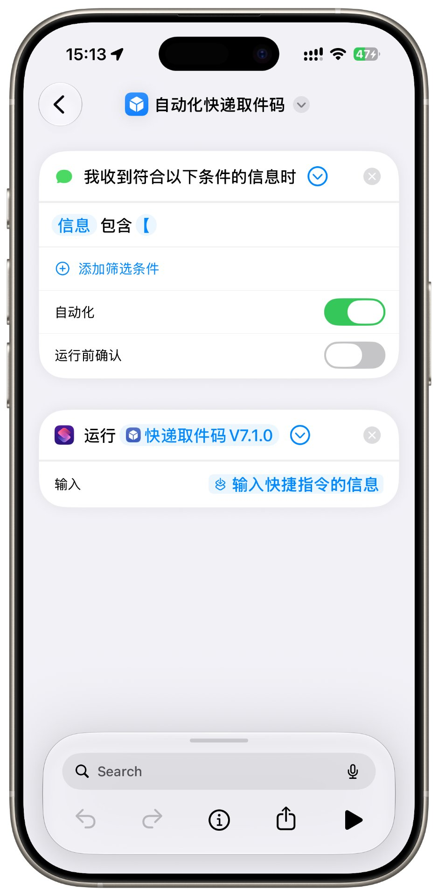

# 快递取件码 快捷指令 · 使用教程

本教程基于「快递取件码」快捷指令的真实操作流编写。指令本体由 115 个动作组成，通过正则从短信中提取取件码、运单号、取件地址，并写入「提醒事项」实现集中管理。全程本地运行，无需第三方 App。

## 一、使用前准备

### 1. 提醒事项列表（无需手动创建）

快捷指令首次运行时会自动检测配置中指定的提醒列表是否存在（默认名称为“待取件📦”）。若不存在，指令会自动创建该列表，因此不需要提前手动新建。

如果你希望使用自定义列表名，只需在指令的“词典”模块中修改“取件列表名称”的值，并与提醒事项中的列表名保持一致即可（指令会自动创建，通常无需手动操作）。

### 2. 开启必要权限

- 打开 iOS「设置 → 快捷指令」，开启「iCloud 同步」与「私人共享」（不同系统版本名称略有差异，核心是允许快捷指令正常安装与运行）。
- 首次运行本指令时，系统会请求「提醒事项」的访问权限，请点击「允许」。若拒绝，指令将无法写入取件记录。

## 二、配置快捷指令参数

在「快捷指令」App 中打开「快递取件码」指令，找到内部的“词典”模块进行配置：

- 取件列表名称：写入结果的目标提醒列表名，默认“待取件📦”。修改后需与实际列表名一致。
- 取件地址：填写 True 显示取件地址，填写 False 隐藏地址。
- 快递公司 / 驿站列表：词典中以字符串数组形式保存了顺丰、圆通、申通、中通、韵达、京东、极兔、菜鸟等数十家快递公司与代收点名称（含 SF、STO、ZTO、EMS、J&T 等英文标识）。这些关键词是指令识别有效取件短信的判断依据。如某家快递或驿站暂未被识别，请将原始短信发送至微信公众号或小红书私信，由作者适配，无需自行修改。

## 三、配置短信自动触发（核心步骤）

本指令的工作逻辑是：手机收到短信 → iOS 自动化检测到内容包含 `【` → 自动运行「快递取件码」指令 → 提取取件信息写入提醒事项。因此，配置短信自动触发是使用本指令的必要前提，而非可选项。

配置步骤如下：

1. 打开「快捷指令」App，点击左侧边栏的「自动化」标签页。
2. 点击右上角「+」，新建「个人自动化」，触发器选择「信息」（图标为绿色对话气泡）。
3. 设置触发条件：
   - 选择「信息 包含」
   - 在输入框中填入 **`【`** （中文左方括号，不含引号）
   - 绝大多数正规快递通知短信均以【公司名】开头，包含 `【` 可有效筛选快递类信息
4. 点击「下一步」进入动作配置界面，在搜索框中搜索并添加「运行快捷指令」动作。
5. 在「运行快捷指令」的下拉列表中选择 **「快递取件码」**。
6. 配置变量传递（关键步骤）：
   - 点击「运行快捷指令」动作下方的「输入」区域
   - 选择「选取变量 → 输入快捷指令的信息」
   - 此操作将本次自动化捕获的完整短信全文作为参数传递给指令进行处理
7. 关闭「确认后运行」，开启「立即运行」，实现收到短信后后台静默处理。

> 注意：配置完成后，自动化默认处于关闭状态（如截图中右上角开关所示）。你需要手动将开关打开才能生效。

## 四、工作逻辑与运行效果

完成上述配置后，日常使用无需任何手动操作——只要收到符合条件的快递短信，系统就会自动完成以下处理：

1. **自动触发**：短信到达且内容包含 `【` 时，iOS 自动化在后台静默触发「快递取件码」指令。
2. **信息传递**：自动化将整条短信全文作为输入变量传递给指令。
3. **智能提取**：指令通过正则从短信中抓取取件码、运单号、快递公司、取件地址或驿站名称。
4. **写入提醒**：结果被整理并写入「提醒事项」的"待取件📦"列表。
5. **推送通知**：写入后推送系统通知，避免漏看。
6. **查看与打勾**：打开「提醒事项」即可看到整理好的取件清单，取件后直接打勾。

**内部机制：**
- 智能去重：同一短信重复推送时，已存在的取件记录会被标记完成，不会生成重复项。
- 循环与分支：指令内部通过循环批量处理多个取件码（如一条短信含多个取件码），通过条件分支应对不同公司、不同短信格式以及是否已记录的情况。

## 六、常见问题

1. **隐私说明**：本指令在设备本地读取短信内容并提取。首次运行需授权提醒事项访问权限；若关闭该权限，指令将无法工作。短信数据仅在本地处理，不联网上传（V7.1.0 的在线版本检查除外，见第 5 条）。
2. **没有自动生成记录**：检查自动化中是否开启了「立即运行」，以及触发条件是否为「信息 包含 【」；同时确认自动化开关已打开（配置完成后默认关闭）。
3. **某家快递无法识别**：如果无法匹配提取取件码，请将原始短信内容发送至**微信公众号或小红书私信**，收到后会着手适配（无需用户自行修改指令）。
4. **多设备同步**：若 iPhone 与 iPad 登录同一 Apple ID 并开启自动化同步，建议仅在一台设备上启用短信自动化，避免重复触发生成两条记录。

## 七、V7.1.0 在线更新说明（重要）

V7.1.0 新增了**在线版本检查**功能：指令启动时会联网拉取仓库中的 `version.json`，比对 `versionCode` 判断是否有新版本。

- **需要联网**：此功能依赖网络请求。如果设备处于离线环境，且未做以下配置，指令可能无法正常运行。
- **如何关闭在线更新检查**：如果你暂时不想联网使用、或不希望每次启动都检查版本，可在快捷指令中找到**第一个字典（配置字典）**，将「更新检查」（或类似名称）的值由 **True** 改为 **False** 即可。关闭后指令将跳过联网步骤，完全离线运行。

> ⚠️ **离线模式 vs 联网模式**：关闭更新检查后，你将不会收到新版本提示。建议在有网络时定期打开检查一次，或在仓库页面手动查看是否有新版发布。

## 附录：iOS 自动化设置参考（iOS 27）

> 以下截图为 iOS 27 系统下的**短信自动化触发**实际配置界面，照着操作即可完成设置。

### 截图说明

上图中包含两个关键配置区域，逐一对照：

#### ① 触发器（上半部分）

| 设置项 | 正确值 | 说明 |
| --- | --- | --- |
| 触发类型 | **我收到符合以下条件的信息时** | 选择「信息」触发器 |
| 条件 | **信息 包含 【** | 填入中文左方括号 `【`（非半角 `[`） |
| **自动化开关** | ✅ **开启**（绿色） | 配置完成后必须手动打开，否则不会自动运行 |
| **运行前确认** | ❌ **关闭**（灰色） | 关闭后收到短信才会在后台静默执行，不会弹窗询问 |

#### ② 动作（下半部分）

| 设置项 | 正确值 | 说明 |
| --- | --- | --- |
| 动作类型 | **运行 快递取件码 V7.1.0** | 在下拉列表中选择本指令 |
| 输入变量 | **输入快捷指令的信息** | 将整条短信内容传给指令处理 |

### 完整配置步骤（7 步）

如果从零开始新建自动化，按以下顺序操作：

1. 打开「快捷指令」App → 左侧边栏点击「**自动化**」标签
2. 点击右上角「**+**」→ 选择「**个人自动化**」
3. 触发器选择「**信息**」（绿色对话气泡图标）
4. 设置条件为「**信息 包含 【**」
5. 点击「下一步」→ 搜索并添加「**运行快捷指令**」动作
6. 选择「**快递取件码 V7.1.0**」，输入设为「**输入快捷指令的信息**」
7. 关闭「**运行前确认**」，打开「**自动化**」开关

> ⚠️ 配置完成后，「自动化」开关默认是**关闭**的。你需要手动打开它才能生效——这是 iOS 的安全机制，防止误触发。
